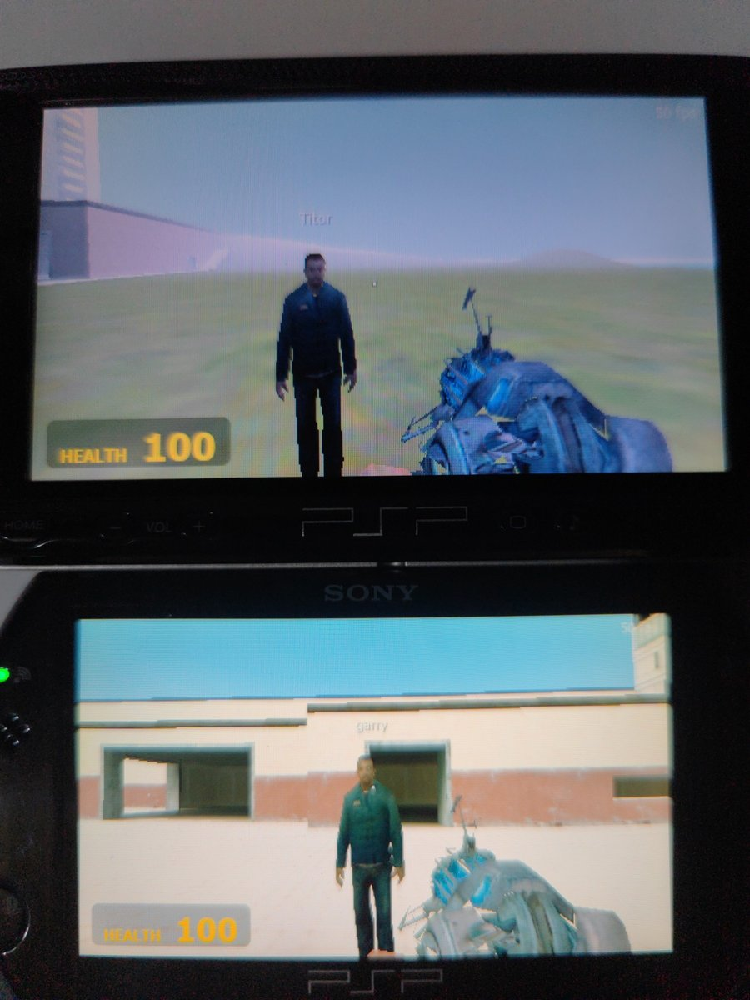

# PSP Sandbox

A Garry's Mod–style sandbox for the PSP, by Retcon. Current version: **1.5.2** (shown in the main menu's corner,
set in `psp/src/version.h`).

- **`psp/`**: the engine, written from scratch in C for the PSP. It draws with the GE (the PSP's graphics chip)
  directly and has its own physics, ragdolls, sound mixer, NPCs, multiplayer and Lua scripting.
- **`tools/bspconv/`**: a PC-side converter (Python). It reads maps, models, textures and sounds from your own
  Garry's Mod and Valve game installs and turns them into compact files the consoles can load.
- **[PS2-GMOD](https://github.com/retcon26/PS2-GMOD)** (a separate repo): the PS2 port. It runs the same engine
  code on the PS2 and reads the same converted data, packed onto a bootable disc image.

**No game content is in this repository.** GMod's and Valve's maps, models, textures and sounds belong to their
owners. You make the game data yourself from the games you own (see [Building](#building)), and builds that
contain it are for your own use. Don't share them.

<p align="center">
  
  <br>
  <em>Two real PSPs in ad-hoc multiplayer on gm_construct: each screen shows the other player, with your own physics gun in first person.</em>
</p>

## What's in it

- **250 maps:** gm_construct and gm_flatgrass, the Half-Life 2 campaign, the original Half-Life campaign
  (converted from GoldSrc), HL2 Deathmatch, Half-Life Deathmatch: Source, Counter-Strike: Source, Day of Defeat:
  Source and Team Fortress 2 maps, plus **gm_construct_13** (see [Maps](#maps)).
- **About 3,200 props:** 186 hand-picked ones in 10 spawnlists, plus about 3,000 more pulled automatically from
  HL2 and its episodes, CS:S, DoD:S, Portal, Portal 2, Left 4 Dead 1 and 2, Fistful of Frags, Black Mesa and TF2,
  in about 160 spawnlists. The extra ones load from the memory stick only when spawned.
- **38 NPCs and 88 ragdolls**, including Team Fortress 2's nine mercenaries (also as player models) and
  characters from Counter-Strike: Source and Half-Life: Source.
- **9 weapons and 17 tool gun tools**, blood and bullet holes, a flashlight, an HEV suit, Lua addons and
  4-player multiplayer with voice chat.
- **Drivable vehicles:** HL2's Jeep and Airboat, and seats to sit on your own contraptions (R switches all their
  thrusters and hoverballs). Spawn them from the Vehicles category; Use gets in and out.

## Targets

| System | RAM for games | Files used |
|---|---|---|
| PSP-2000 / 3000 / Go / Street (primary) | ~52 MB | full detail: `name.pmap`, `props.ppak`, `npcs.pnpc`, `sounds.psnd` |
| PSP-1000 | ~24 MB | `*.low.*`: half-size textures, coarser geometry, 16 kHz sound, no ragdoll-only characters |
| PS2 | 32 MB | full detail when it fits, otherwise the `.low` version of that map |

The game measures free memory at startup and picks the right files. If a full-detail map doesn't fit when you
load it, it falls back to the map's low-detail version.

## Playing

`psp/make_release.ps1` lays the game out ready to copy: `psp/release/PSP/GAME/PSPSandbox/` holds `EBOOT.PBP`,
`CONTROLS.txt` and the `data` folder.

- **Real PSP** (needs custom firmware for homebrew): copy `release/PSP` to the root of the memory stick.
- **PPSSPP on PC:** File > Load, and pick `EBOOT.PBP` in that folder (the `data` folder must sit next to it).
  Set Settings > System > PSP model to **PSP-2000/3000** for full detail.
- **PPSSPP on iPhone / iPad:** there's no special version. Copy `release/PSP` into Files > On My iPhone >
  PPSSPP, set the PSP model as above, and start it from the Games tab. Apple doesn't allow PPSSPP's fast CPU
  mode on iOS, so lower Draw distance and Physics quality if it's slow.

The full data is about 2.2 GB, nearly all of it maps. To save space, delete maps you don't play from
`data/maps`: each map is two files, `name.pmap` and `name.low.pmap`.

## Controls

The full list is in [psp/CONTROLS.txt](psp/CONTROLS.txt).

| Action | PSP | PS2 (DualShock 2) |
|---|---|---|
| Walk (swim in deep water) | Analog stick | Left stick |
| Look | Triangle / Cross / Square / Circle | Right stick |
| Fire / primary | R | R1 or R2 |
| Jump (noclip: fly up) | L | X, or L1 / L2 |
| Next weapon | D-pad Left (tap) | D-pad Left |
| Reload | D-pad Left (hold) | Circle |
| Use (doors, buttons, thrusters) | D-pad Right (tap) | D-pad Right or Triangle |
| Carry a light prop | D-pad Right (hold, on the prop) | D-pad Right or Triangle (hold) |
| Flashlight | D-pad Right (hold) | Square |
| Undo the last spawn | D-pad Up | D-pad Up |
| Crouch on/off (noclip: fly down) | D-pad Down | D-pad Down |
| Spawn menu (L/R switch panel, X selects, O closes) | Select (tap) | Select (tap) |
| Noclip on/off | Select (hold) | Select (hold) |
| Pause menu | Start | Start |

While you carry a prop, jumping, crouching, undo and switching weapons are off. The D-pad turns, pushes and
pulls the prop instead.

## Weapons

| Weapon | Controls |
|---|---|
| Hands | R picks up something light (up to 35 kg, close by) or drops it. L throws it. |
| Physics Gun | Hold R to grab any prop or any ragdoll limb, at any distance. L freezes it in place. D-pad turns it and moves it nearer or further. |
| Gravity Gun | PSP: R pulls in a prop up to 250 kg from up to 1000 units and holds it, R again drops it, L launches it. PS2: L1 picks up and drops, R1 punts. On both, picking up something too heavy within 250 units punts it instead. |
| Tool Gun | R uses the tool picked in the spawn menu's Tools panel. |
| Crowbar, Pistol, .357, SMG, Shotgun | R fires. Reload when empty (or turn on Options > Unlimited ammo). |

Every weapon is shown with GMod's first-person model and the citizen's arms.

Tool gun tools (the Tools list scrolls):

| Group | Tool | What it does |
|---|---|---|
| Construction | Balloon | Ties up to 4 balloons that lift the prop. |
| | Duplicator | R on a prop copies it, R on the ground pastes the copy. |
| | No-Collide | The prop passes through other props (it still hits the world). R again undoes it. |
| | Remover | Deletes the prop, NPC or ragdoll you aim at. |
| | Weight | Steps the prop's mass through 1, 10, 50, 250 and 1000 kg. |
| Constraints | Ball Socket | Pick a prop, then what to attach it to: they share that point but swivel freely. |
| | Elastic | Pick two points: a stretchy band that pulls them together. |
| | Rope | Pick two points: they can't move further apart than the rope. |
| | Slider | Pick two points: the prop slides along the line between them. |
| | Weld | Pick a prop, then a second prop (or the world): joined rigidly. |
| Mechanics | Explosive | Blows the prop up: nearby props fly, NPCs and you get hurt. |
| | Hoverball | Holds the prop at the height where you put it. |
| | Thruster | Pushes the prop the way you shot it in. |
| Poser | Inflator | Makes the ragdoll body part you aim at bigger (up to 4x). |
| | Deflator | Makes it smaller (down to 0.2x). |
| Render | Camera | R places a camera facing where you look; L switches your view through each camera and back to you. Cameras are props: move them with the physics gun or weld them to a car. |
| | Colour | Paints the prop. |

Use (D-pad Right) on a prop switches its thrusters and hoverballs on and off.

## Spawn menu

- **Props:** 186 in 10 spawnlists (Construction, Junk, Furniture, Misc, Vehicles, Shapes, Street, Combine, Food,
  Lab), then about 3,000 extra props from 12 games, each game's in its own spawnlists. Up to 40 spawned props per
  player, plus the map's own physics props.
- **NPCs:** 29: zombies (classic, fast, poison, Zombine, Zombie Torso), headcrabs, antlions and an antlion guard,
  Combine soldiers, Elites, Prison Guards and Metrocops, rebels and medics, citizens, and HL2's main characters.
- **Ragdolls:** every NPC, plus 50 ragdoll-only characters: more HL2 people and creatures, CS:S's counter-terrorists,
  terrorists and hostages, Half-Life: Source's scientist, Barney, grunts and aliens, Gordon Freeman, DoD:S
  soldiers and Chell. (The PSP-1000 has room for the NPCs' ragdolls only.)

## NPCs

- **Zombies, antlions and headcrabs** chase you and attack. Zombies wear their headcrabs, and when a zombie dies
  its crab jumps off and comes after you.
- **A thrown Sawblade cuts a classic zombie in half**, as in HL2: the legs fall as a ragdoll and the top half
  carries on crawling as a Zombie Torso, headcrab and all.
- **Combine** shoot at you, rebels and monsters. **Rebels and medics** follow you and fight them. **Citizens**
  wander and run away. Armed NPCs hold their guns the way HL2 bone-merges them.
- **Voices:** NPCs say pain, death and alert lines in their own voices.
- **Ragdolls:** NPCs fall as verlet ragdolls when they die. Shots and props push them, and the physics gun drags
  and freezes them.
- **Options > NPC thinking** freezes them in place (GMod's `ai_disabled`), and **NPCs ignore players** stops them
  targeting or following you (`ai_ignoreplayers`).

## Options

Sound, look speed, invert look, God mode (also games you host), player model, third-person view, NPC thinking,
NPCs ignore players, unlimited ammo, HEV suit (100 suit power at spawn that takes 80% of the damage, as in HL2),
show HUD, crosshair, show FPS, draw distance, physics quality, debug overlay, and the credits.

## Maps

`tools/maps.txt` lists 250 maps, converted from your installs:

| From | Maps |
|---|---|
| Garry's Mod | gm_construct, gm_flatgrass |
| Half-Life 2 | the whole campaign (`d1_`, `d2_`, `d3_`) |
| Half-Life | the whole original campaign, converted from GoldSrc (`hl1_`) |
| HL2 Deathmatch | `dm_` maps |
| Half-Life Deathmatch: Source | crossfire, bounce, datacore, frenzy, stalkyard, undertow and more |
| Counter-Strike: Source | `cs_` and `de_` maps |
| Day of Defeat: Source | `dod_` maps |
| Team Fortress 2 | 22 official maps, one or more of each mode: 2Fort, Turbine, Dustbowl, Granary, Badwater, Gold Rush, Viaduct, Hydro, Hightower, Doomsday, Mannworks and more |

The list also has **gm_construct_13**: gm_construct at night, in thick dark fog. A black figure turns up in the
distance now and then, at the edge of your view. Look straight at it, or walk towards it, and it's gone. It reuses
gm_construct's files, so it takes no extra space.

## Multiplayer

Up to 4 players. The host runs the physics, NPCs, ragdolls and doors. Pick Multiplayer > Host Game or Join Game.
Everyone needs the same version (the menu's corner shows it). Guns and the crowbar hurt other players (not with God
mode on), and everyone sees the same ragdolls: the host simulates them and sends their poses. Vehicles work for
everyone: the host drives them for whoever is inside.

**Voice chat (PSP):** hold D-pad Up to talk (a quick tap still undoes). It uses the PSP-3000's built-in
microphone, or a headset's on a PSP-2000. The mic is only switched on while you hold Up. Speech is sent as
4-bit ADPCM at 11 kHz (about 5.5 KB/s), and the host passes it on to everyone else.

- **PSP:** ad-hoc wifi between PSPs (or PPSSPP instances with ad-hoc networking set up).
- **PS2:** over a network adapter on the same local network (a fat PS2 with the adapter, a slim PS2, or PCSX2).

The PSP and PS2 versions can't play together.

## Lua addons

Every `.lua` file in `data/lua/autorun/` runs when a map loads, and `data/lua/maps/<map>.lua` runs on that map
only. The API is a small GMod-flavoured subset: `hook.Add` (`Think`, `PlayerUse`, `HUDPaint`), `timer.Simple`,
`ents.CreateProp/Remove/GetPos/SetPos/SetVelocity/SetColor/Freeze`, `player.GetPos/GetYaw/GetAimEntity`,
`draw.Text`, `print`. See [psp/data/lua/autorun/example.lua](psp/data/lua/autorun/example.lua): Use on a prop
launches it.

## Building

### Setup (one time)

1. WSL with Ubuntu, then in Ubuntu:
   `sudo apt-get install -y build-essential cmake pkgconf libusb-0.1-4 fakeroot python3-numpy python3-pil`
2. The PSP SDK ([pspdev](https://github.com/pspdev/pspdev)) in `~/pspdev`. For the PS2 build, the PS2 SDK
   (ps2dev) in `~/ps2dev`.
3. Garry's Mod, plus whichever other Valve games you want maps and props from, installed through Steam. The
   converter looks for each game in `/mnt/d/SteamLibrary/steamapps/common/`, then in Steam's own folder on C:
   (change `DEFAULT_GMOD` in `tools/bspconv/__main__.py` and `LIBRARIES` in `tools/bspconv/steam.py` if your
   libraries are elsewhere). If one is on another drive, mount it in Ubuntu: `sudo mkdir -p /mnt/d && sudo mount -t drvfs D: /mnt/d`.

### Making the data and the EBOOT

Close PPSSPP first (it locks the EBOOT). In Ubuntu, from the repo:

```
bash tools/rebuild_all.sh
```

This converts every map in `tools/maps.txt`, builds the packs in `psp/data/`, and builds `psp/EBOOT.PBP`. You can
also run the steps on their own:

| Step | Command | Input |
|---|---|---|
| One map | `tools/bspconv.sh convert <map.bsp>` | a `.bsp` (Source or GoldSrc) |
| New maps only, in parallel | `tools/convert_new.sh [jobs] [all]` | `tools/maps.txt` |
| Props and weapon models | `tools/bspconv.sh props` | `tools/props.txt` |
| Extra props from the other games | `tools/bspconv.sh extras` | the installed games |
| NPCs and ragdolls | `tools/bspconv.sh npcs` | `tools/npcs.txt` |
| Animated first-person weapons | `tools/bspconv.sh vmodels` | `tools/props.txt` (its `vm` models) |
| Sounds | `tools/bspconv.sh sounds` | `tools/sounds.txt` |
| Fonts, spawn icons, map thumbnails | `tools/bspconv.sh ui` | the lists above |
| PSP EBOOT | `psp/build.sh` | `psp/src/` |
| Ready-to-copy folder | `powershell -File psp/make_release.ps1` | `psp/EBOOT.PBP`, `psp/data/` |

The NPC step writes three packs: `npcs.pnpc` (full detail), `npcs.low.pnpc` (PSP-1000) and `npcs.ps2.pnpc` (the
PS2's: low detail but with the ragdoll-only characters).

The weapons step bakes GMod's `c_` weapon models, with the player's arms bone-merged on, into `vmodels.pvmd` (full
detail) and `vmodels.low.pvmd` (PSP-1000 and PS2): their draw, idle, fire and reload animations, so the weapon in
your hands moves. Without the pack the game shows the still models from the prop pack instead.

## What gets converted

- **Map geometry:** brush faces and displacements become indexed triangles. Faces are cut on a world-aligned
  grid only where their lightmap has detail. Vertices are packed into 16 bytes (16-bit UV and position).
- **GoldSrc maps** (Half-Life): brushes are rebuilt from the collision hull's BSP tree, lighting is converted to
  Source's format, and textures come from the WAD files.
- **Lighting:** baked lightmaps become vertex colours (drawn with the GE's 2x colour doubling). Props are lit by
  the map's per-area ambient light plus the sun, with a shadow test toward the sun.
- **Textures:** VTF base textures are cut to 128px (or 64px), reduced to 256-colour paletted (T8), swizzled, and
  given mip levels. On the PSP the most-used ones are copied into the free ~1.2 MB of VRAM at load.
- **Visibility:** batches of triangles per 1024-unit cell and material, plus static props, each get a bitset of
  what every BSP cluster can see.
- **Collision:** map brushes (with bevels), displacement triangles as prism brushes, static brush entities, and
  the convex pieces of solid static props (so a door frame leaves its doorway open).
- **Entities:** sliding and swinging doors, buttons, fans and triggers, linked by the map's I/O outputs
  ("button OnPressed -> door Open"). Static props and the map's physics props come with their models.
- **Props:** MDL/VVD/VTX models at a LOD that fits a triangle budget (simplified when there's no low LOD), with
  real masses, surface types and convex collision hulls from `.phy`.
- **Weapons:** GMod's `c_` models with `c_arms_citizen` bone-merged onto them, posed in the idle animation and
  baked into one mesh. The physics gun is the gravity gun's model with its colours turned blue.
- **NPCs:** rigid-skinned models with idle, walk, run, attack and death animations baked into per-bone matrices,
  their headcrab and waist bones marked for zombies, and guns lined up on the hand bone as Source does.
- **Sound:** WAV (PCM and MS-ADPCM), mono, at 44.1 kHz (16 kHz on the PSP-1000), mixed in 16 voices with 3D panning.

## Physics and collision

- **Props:** boxes, spheres, cylinders or convex hulls, handled as surface sample points. Contacts use sequential
  impulses with friction, and there are welds, ball sockets, ropes, elastics, sliders, thrusters, hoverballs,
  buoyancy in water, sleeping and freezing.
- **Fast props** sweep their path, so they stop at thin walls instead of passing through.
- **Player and NPCs** collide with props' real rotated shapes. If a prop is pushed into you, you can walk out of it.
- **World traces** follow the BSP tree along the path, so long traces never miss walls.
- **Ragdolls:** verlet ragdolls with braced joints that collide with the world and props.
- **Blood and bullet holes:** shots and hits on flesh spray drops and leave HL2's blood splats; bullets leave
  holes in walls and props (on props they move with it), by the prop's material. They're drawn like HL2's
  modulate decals (the surface times the texture), so they're lit with the surface, and are lifted off it by more
  the further away they are, so the PSP's 16-bit depth buffer doesn't make them flicker. Splats that would hang
  over an edge are made smaller. Pause > Clean Up Props clears them.
- **Vehicles:** one rigid body each. The Jeep rides on four raycast wheels with springs, grip, steering and
  all-wheel drive; the Airboat on four floats that also sit on water, pushed by its fan and turned by its rudders.

## Versions

| Version | Changes |
|---|---|
| 1.5.2 | Spawn menu: the other games' spawnlists grouped under a header per game; a Recent list; a badge on drivable vehicles and seats; all four grid columns fit |
| 1.5.1 | Voice chat in multiplayer: hold D-pad Up to talk (PSP-3000's built-in mic, or a headset) |
| 1.5.0 | Drivable Jeep and Airboat; seats for riding your contraptions; bullet holes; blood and holes with HL2's decal textures, no more flicker |
| 1.4.0 | Team Fortress 2: 22 maps, its nine mercenaries as NPCs, ragdolls and player models, and about 390 of its props |
| 1.3.0 | Animated first-person weapons; guns and the crowbar hurt other players in multiplayer; everyone sees the same ragdolls; PS2: props, NPCs and ragdolls on VU1 (about twice the frame rate) |
| 1.2.0 | NPC guns held properly; sawblades cut zombies in half; the Zombine and Zombie Torso as NPCs |
| 1.1.0 | Camera tool |
| 1.0.1 | Fixes for ragdoll crashes on real PSPs |
| 1.0.0 | Version label; unlimited ammo and HEV suit options; CS:S and Half-Life: Source ragdolls |

## Roadmap

- [x] PSP renderer, camera, memory tier detection; full and low detail tiers
- [x] BSP / VPK / VMT / VTF readers; GoldSrc (Half-Life) maps
- [x] Collision and Source-style movement (jump, crouch, stairs, slopes, swimming, noclip)
- [x] Props with physics, constraints and water; physics gun, gravity gun, tool gun; spawn menu, undo
- [x] Doors, buttons, fans, triggers and outputs; static props; map physics props
- [x] Skybox textures and light styles
- [x] Lua scripting layer
- [x] NPCs with baked skeletal animation, voices, weapons and ragdolls; headcrabs; sawblade cuts
- [x] Weapons with first-person models; blood; flashlight; HEV suit
- [x] Thousands of extra props from other Source games
- [x] Multiplayer (PSP ad-hoc, PS2 LAN), up to 4, host-authoritative
- [x] PS2 port, with map geometry on the VU1 coprocessor
- [x] Camera tool; Poser tools (Inflator, Deflator); unlimited ammo and HEV suit options
- [x] PS2 speed: props and NPCs on VU1 too
- [x] Animated first-person weapons; PvP damage; synced ragdolls
- [x] Team Fortress 2's maps, props and characters
- [x] Drivable Jeep and Airboat; seats for contraptions; bullet holes and decals; voice chat

- [ ] **Save and load:** builds saved to the memory stick or memory card and loaded back on any map, and Options
      saved on the PS2 too
- [ ] **More tools:** Wheel, Winch, Hydraulic, Lamp, Light, Button and Emitter
- [ ] **More weapons:** RPG, crossbow, grenades, AR2 and bugbait (antlions follow you)
- [ ] **NPC navigation:** routes along the map's own node graph (`info_node`), so NPCs walk round walls instead
      of into them
- [ ] **Face and finger posing:** Face Poser expressions and Finger Poser hands for ragdolls
- [ ] **Effects:** sparks on metal, smoke, fire after explosions, muzzle smoke and tracer impacts
- [ ] **Lua gamemodes:** a bigger Lua API and small gamemodes built on it, like Prop Hunt and a zombie survival mode
- [ ] **More player customization:** on top of picking a player model, a player colour, model skins and
      bodygroups, and a weapon colour for the physics gun
- [ ] **Quick chat:** a radial menu of short messages and gestures for multiplayer, since the consoles have no
      keyboard
- [ ] **Share builds:** send a saved build to the other players in the game over ad-hoc or LAN
- [ ] **Day, night and weather:** a time-of-day option with fog and rain, built on gm_construct_13's fog
- [ ] **Screenshots:** a pause menu button that saves the screen to the memory stick or memory card
